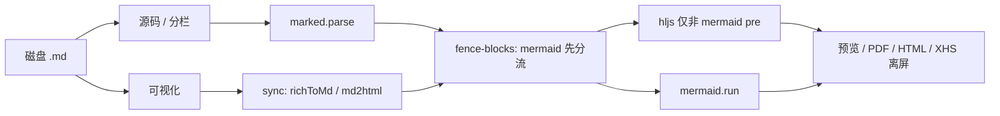

# Mermaid 图表 · 块级编辑 · 工具栏延续方案

| 字段 | 内容 |
|------|------|
| 文档版本 | **v1.2** |
| 日期 | 2026-10-27 |
| 状态 | **已验收**（2026-10-27；见 [MERMAID_ACCEPTANCE.md](./MERMAID_ACCEPTANCE.md)） |
| 关联代码 | `mobimark_source/mobimark/src/renderer/app.js`、`index.html`、`style.css`、`context-menu.js`；`src/main/main.js`（PDF）；小红书导出逻辑同 `app.js` |
| 触发场景 | `xciv参考重构/10_产品逻辑分层图.md`、`11_用户交互路径图.md` 等含 ` ```mermaid ` 与总览 PNG 的产品文档 |
| 相关台账 | [EDITOR_BUGS.md](./EDITOR_BUGS.md)、[XHS_EXPORT_AUTO_SPLIT_PLAN.md](./XHS_EXPORT_AUTO_SPLIT_PLAN.md)、[XHS_EXPORT_BUGS.md](./XHS_EXPORT_BUGS.md) |

---

## 1. 背景与问题

### 1.1 用户文档形态

典型产品架构文档同时包含：

1. **文首总览图**：``，可由脚本离线生成（如 PIL / mermaid-cli）。
2. **正文多段 Mermaid**：`flowchart`、`sequenceDiagram`、`stateDiagram-v2` 等，作为可 diff 的「图源」。
3. **表格与说明**：GFM 表格、层级说明，与图表交错排版。

### 1.2 彭兔子 MD 现状（v1.0.36 基线）

| 能力 | 现状 | 对用户的影响 |
|------|------|----------------|
| 渲染 | `marked` + `highlight.js`，**无 Mermaid** | 预览里 Mermaid 围栏显示为高亮代码，不是图 |
| 可视化 | `md2html` → contenteditable | 同上，只见「逻辑文本」 |
| `richToMd` | `<pre>` 一律导出为 ` ``` ` **无语言标记** | 源码里 ` ```mermaid ` 经可视化往返可能丢 `mermaid` 标签 |
| 工具栏 | 已有行内代码、**代码块**（`insertCodeBlock`）、**图片**（`insertMarkdownImageAtCursor`） | 无「图表块」、无围栏语言选择、图片块无统一块级 UI |
| PDF | `renderPreview()` → `printToPDF` | 仅 PNG 图片进 PDF；Mermaid 围栏仍是代码 |
| 小红书导出 | 块级分页 + 代码行拆分 | Mermaid 未渲染时按 `pre` 文本分页，体验与 PRD 目标不符 |

### 1.3 产品目标（一句话）

**Markdown 仍是唯一真源**；在预览与可视化中把 Mermaid 当「图块」展示与编辑；导出 PDF / HTML / 小红书时输出**已渲染的矢量或位图**；工具栏支持**插入代码块、图片块、图表块**；远期（阶段 C）对 flowchart 提供**画布级拖拽编辑**并写回源码。

---

## 2. 目标与非目标

### 2.1 分阶段目标

| 阶段 | 名称 | 交付概要 | 验收文档 |
|------|------|----------|----------|
| **A** | 渲染与导出闭环 | 预览 / PDF / HTML / 小红书路径能稳定画出 Mermaid；围栏语言往返不丢 | `10_`、`11_` 全文预览与 PDF 含全部图 |
| **B** | 可视化图块 + 工具栏块 | 可视化内图块 widget；工具栏「插入」分组：代码块 / 图片 / 图表 | 可视化插入图表 → 保存 → 再打开一致 |
| **C** | Flowchart 可视化编辑 | 拖拽节点、连线；可选 mermaid.live 外链；布局注释持久化 | 改画布后 md 可 diff、预览一致 |

### 2.2 非目标（本方案不做或后置）

- 用 ProseMirror / Lexical **整体替换**可视化编辑器（列为 **§14** 长期选项）。
- 序列图 / 状态图 / 甘特图的**全类型**画布编辑（行业惯例：仅 flowchart WYSIWYG，其余改源码 + 实时预览）。
- 云端图表协作、版本库内嵌 draw.io（可单列后续 PRD）。
- 自动用 AI 从表格生成 Mermaid（产品外能力）。
- **发版级 Electron 真机截图对比**（列为 §9.7 可选；默认不阻塞 release）。

---

## 3. 行业对标（决策依据）

| 产品 | 展示 | 编辑 | 导出 |
|------|------|------|------|
| Typora | 编辑区直接渲 Mermaid | 改围栏源码 | PDF/HTML 带 SVG |
| Obsidian | 预览内置 Mermaid | 源码 + 插件链 mermaid.live | Enhanced PDF 等：**等待渲染完成**再打印 |
| Notion | Code 块语言 Mermaid，Split 视图 | 改块内文本 | 不稳时嵌 PNG |
| VS Code | 预览渲 Mermaid | ceasg 扩展：flowchart 拖拽写回 md | 打印 / mmdc 预渲 |
| Markdown Live Preview Editor | 预览内嵌 SVG + `</>` 改源码 | Obsidian 式 | 随预览 |

**采纳原则**

1. **真源**：磁盘上始终是 ` ```lang\n...\n``` ` 或 ``。
2. **渲染**：客户端 `mermaid.run()`；导出前 `await renderMermaidIn(root)`。
3. **宽图**：打印与小红书用 `max-width:100%`、`break-inside: avoid`；超大图单独分页策略（对齐 [XHS_EXPORT_AUTO_SPLIT_PLAN](./XHS_EXPORT_AUTO_SPLIT_PLAN.md) P2）。
4. **可视化编辑**：阶段 B 用「图 + 源码面板」；阶段 C 仅对 flowchart 引入画布（可参考 ceasg 的 `%%` 布局注释，或 iframe mermaid.live）。

---

## 4. 总体架构

### 4.1 模块划分（建议新增文件，避免 `app.js` 再膨胀）

| 模块 | 路径（建议） | 职责 |
|------|----------------|------|
| `mermaid-runtime.js` | `src/renderer/mermaid-runtime.js` | 加载配置、主题映射、`renderMermaidIn(container)`、`waitForMermaidIdle()` |
| `fence-blocks.js` | `src/renderer/fence-blocks.js` | **可单测**：围栏解析、`marked` HTML 后处理（mermaid 与 hljs 分流）、`diagramBlockToFenceMd` |
| `diagram-widget.js` | `src/renderer/diagram-widget.js` | 阶段 B/C：DOM widget、工具条、编辑弹层 |
| `block-insert.js` | `src/renderer/block-insert.js` | `insertCodeBlock` / `insertImageBlock` / `insertMermaidBlock` |
| `selfcheck-mermaid.js` | `scripts/selfcheck-mermaid.js` | 静态：依赖、管线顺序、PDF/HTML 钩子 |
| `rich-md-roundtrip.js` | `src/renderer/rich-md-roundtrip.js` | **可单测**：`mdToRichHtml` / `richHtmlToMd`（从 `nodeToMd` 抽离，供 jsdom 全链路） |
| `selfcheck-mermaid-roundtrip.js` | `scripts/selfcheck-mermaid-roundtrip.js` | 逻辑：fixtures md ↔ fence（`fence-blocks.js`） |
| `selfcheck-mermaid-dom-roundtrip.js` | `scripts/selfcheck-mermaid-dom-roundtrip.js` | **jsdom**：fixtures 全链路 md → html → 合成 rich DOM → md |
| `selfcheck-mermaid-blocks.js` | `scripts/selfcheck-mermaid-blocks.js` | 静态：阶段 B；校验 manifest 键已在 UI 引用（M3 起） |
| `smoke-mermaid-render.js` | `scripts/smoke-mermaid-render.js` | **M2**：Electron 无头窗或 `mermaid`+jsdom 断言 SVG 节点存在 |
| `sync-xciv-diagram-fixtures.js` | `scripts/sync-xciv-diagram-fixtures.js` | 可选：从 `XCIV_REF` 路径刷新 fixtures 关键段 |
| `mermaid-i18n-manifest.json` | `src/shared/mermaid-i18n-manifest.json` | **i18n 唯一清单**（`selfcheck-locales` 已校验） |
| `selfcheck-mermaid-flowchart.js` | `scripts/selfcheck-mermaid-flowchart.js` | 静态：阶段 C 外链与画布开关（M5/M6 起启用） |

`app.js` 保留编排：`renderPreview`、`buildHtmlForExport`、`exportPdf`、小红书离屏 DOM 均调用同一 **`preparePreviewHtml(md)`**（内部：marked → `fence-blocks` 后处理 → mermaid/hljs）。

### 4.2 数据流（阶段 A 起）



### 4.3 围栏在 Markdown 中的契约

磁盘格式（info string 为 `mermaid`）：

    ```mermaid
    flowchart TB
      A --> B
    ```

| 字段 | 规则 |
|------|------|
| 语言标识 | 仅当 info string 为 `mermaid`（大小写不敏感）时走图表管线 |
| 其它语言 | 仍走 highlight.js（`js`、`python`…） |
| 可视化 DOM | 阶段 A：`<pre><code class="language-mermaid">`；阶段 B：外层 `div.diagram-block[data-fence="mermaid"]` + 镜像源码 |
| 往返 | `richToMd` 必须输出 ` ```mermaid\n` + 正文 + `\n``` `；**不得**把渲染后的 SVG 路径写入 md |
| 管线顺序 | **必须先**把 mermaid 块换成 `.mermaid` 容器，**再**对剩余 `pre` 调 hljs（自检强制） |

---

## 5. 工具栏与「块」产品规格

### 5.1 工具栏信息架构（可视化 `#rich-toolbar`）

在现有格式按钮后增加 **「插入」** 分组（与表格、分割线同级，避免挤爆首屏时可收进 `插入 ▾` 下拉）：

| 控件 ID（建议） | 文案 | 行为 |
|-----------------|------|------|
| `r-insert-menu` 或分拆按钮 | 插入 ▾ | 下拉：代码块 / 图片 / 图表 / （可选）围栏… |
| `r-codeblock` | 代码块 | **保留**；增强为可选语言（默认 plain） |
| `r-image` | 图片 | **保留**；阶段 B 统一为「图片块」样式与右键菜单 |
| `r-mermaid` | 图表 | **新增**：插入默认 `flowchart LR` 模板或空模板 |
| `r-fence`（可选） | 围栏块 | 通用 ` ```lang `，语言下拉：无 / mermaid / js / … |

**Markdown 工具栏 `#md-toolbar`** 同步：`fmt-mermaid`、`fmt-insert-menu`；插入时在光标处写围栏文本（与可视化语义一致）。

### 5.2 块级 UI 规范（阶段 B）

| 块类型 | 可视化外观 | 交互 | 写入 Markdown |
|--------|------------|------|----------------|
| **代码块** | 灰底 `pre`，左上角语言标签，复制按钮 | 点击进入编辑；失焦同步 | ` ```lang\n...\n``` ` |
| **图片块** | `figure.image-block`：图 + 可选说明 | 替换/复制路径（已有右键） | `` |
| **图表块** | 渲 SVG + 顶栏：编辑源码 / 刷新 / 在浏览器打开 / 复制源码 | 默认只读图；编辑侧栏或模态 | ` ```mermaid\n...\n``` ` |

**代码块复制按钮**：`attachCodeBlockCopyButtons` **不得**包裹已升级为 `.diagram-block` / `.mermaid` 的节点（避免拆 DOM）。

**焦点与撤销**：插入块、`recordRichHistory({ discrete: true })`；编辑图表源码结束后再记一步（对齐 [UNDO_COALESCE_PLAN](./UNDO_COALESCE_PLAN.md)）。

### 5.3 右键菜单（`context-menu.js`）

- `ins-mermaid`：插入图表块  
- `ins-fence`：插入带语言围栏（子菜单选语言）  
- 图表块：`diagram-edit`、`diagram-copy-source`、`diagram-delete`、`diagram-open-live`（阶段 C）

### 5.4 默认模板（插入图表）

默认插入最小 `flowchart LR`（两节点），与 §5.2 图表块一致；支持从剪贴板粘贴完整 ` ```mermaid ` 围栏自动识别（P2）。

---

## 6. 阶段 A — 渲染与导出闭环

### 6.1 依赖与打包

- 新增 npm：`mermaid`（锁定主版本，与 Electron Chromium 兼容）。
- `index.html` 或 bundler 路径必须在 **asar 内可加载**（`selfcheck-mermaid` 检查 script 引用存在）。
- 不默认引入 `@mermaid-js/mermaid-cli`（可选：xciv PNG 同步脚本 / CI）。

### 6.2 渲染管线改动

1. **`preparePreviewHtml(md)`**（新建，供预览 / HTML / 小红书离屏共用）  
   - `marked.parse` → `fence-blocks.promoteMermaidFencesInHtml(html)`  
   - 对剩余 `pre > code` 执行 hljs  
   - `await renderMermaidIn(root)`（预览 DOM 或离屏 host）

2. **`mermaid.initialize`**：`startOnLoad: false`；`securityLevel: 'strict'`。

3. **错误处理**：单块 parse 失败 → 块内错误条 + 可展开源码；**不得** reject 整篇 `renderPreview`（避免 ED-001 类全页卡死）。

4. **防重复渲染**：已有 `svg` 的 `.mermaid` 跳过；**主题变更**强制清缓存重渲。

5. **并发**：同一文档多图时 `data-diagram-id` 全局唯一（`mermaid-${n}` 或内容 hash），避免 id 冲突。

6. **预览渲染代际（固定 API，M1 实现并写入 `selfcheck-recent-fixes`）**  

| 符号 | 类型 | 行为 |
|------|------|------|
| `_previewRenderSeq` | `number` | 单调递增；每次发起新预览渲染前 `++` |
| `beginPreviewRender()` | `function` | 返回当前 `seq`，并 invalidate 进行中的 mermaid |
| `isPreviewRenderStale(seq)` | `function` | `seq !== _previewRenderSeq` 时丢弃 DOM 写入 |
| `setMode` / `setTheme` | 调用点 | 切换前调用 `beginPreviewRender()`，避免 ED-001 类「旧渲染写回新视图」 |
| `window.__pongrabbitMermaidReady` | `Promise` | 当前代际全部 `renderMermaidIn` 完成；PDF 等待此 Promise |

`selfcheck-recent-fixes.js` 静态断言：`beginPreviewRender`、`isPreviewRenderStale` 存在，且 `renderPreview` 内在写 `previewEl.innerHTML` 前检查 stale。

### 6.3 PDF（`main.js` `export-pdf`）

推荐路径：**renderer 导出前**在预览 HTML 中已完成 mermaid（与 `exportPdf` 已存在的 `await renderPreview()` 一致），临时 PDF 页仅 **等待** 而不再跑第二套逻辑：

```js
await document.fonts.ready
await window.__pongrabbitMermaidReady?.()
```

若 PDF 页为独立 HTML 文件，则须在 `buildPdfExportDocument` 内联 mermaid 脚本并调用同一 `__pongrabbitMermaidReady`（`selfcheck` 二选一路径至少命中其一）。

**打印 CSS**（`style.css` `@media print` 或 PDF 内联）：

```css
.mermaid, .mermaid svg {
  max-width: 100% !important;
  height: auto !important;
}
.mermaid {
  page-break-inside: avoid;
  break-inside: avoid;
  margin: 16px 0;
}
```

### 6.4 HTML 导出

**验收标准**：双击导出 HTML **离线打开**可见图。实现二选一（须在 `selfcheck-mermaid` 中断言采用了哪一种）：

| 策略 | 说明 |
|------|------|
| **A（推荐）** | 导出前把每个 `.mermaid` 替换为 **inline SVG** 字符串，删除对 mermaid.js 的依赖 |
| **B** | `<head>` 内嵌 `mermaid.min.js` +  onload 脚本（路径须相对导出目录或 file:// 可解析） |

### 6.5 小红书导出

| 情况 | 策略 |
|------|------|
| 阶段 A | 离屏 host 走 `preparePreviewHtml` + `renderMermaidIn`；分页 **`kind: 'mermaid'`**，整块不拆行 |
| Mermaid 不得进 `fence-line` / `pre-line` | 渲染前升级块，或导出分页扫描时识别 `.mermaid svg` 父盒为原子单元 |
| 高度 > 单页 | 整图缩放到页高；成功提示可注明「图表已缩放」 |
| P2 宽 sequence | 横向过长时缩放优先；必要时整页横图（见 [XHS_EXPORT_AUTO_SPLIT_PLAN](./XHS_EXPORT_AUTO_SPLIT_PLAN.md)） |

### 6.6 `richToMd` / `md2html` 最小修复（阶段 A 必须）

- `nodeToMd`：`pre` 内 `code.language-*` → ` ```${lang}\n...\n``` `（`mermaid` 保留）。  
- 空语言：` ```\n...\n``` `。  
- `md2html`：marked 保留 GFM 围栏语言。

**验收**：fixtures 往返 + 打开 `10_` 不改内容保存，围栏仍为 ` ```mermaid `。

### 6.7 阶段 A 验收清单

- [ ] 预览：文首 PNG + 全部 Mermaid 段为图。  
- [ ] PDF / HTML：同上（HTML 离线）。  
- [ ] 小红书：fixtures 含 `wide-sequence.md` 短图成功，无未处理 overflow 弹窗。  
- [ ] 主题切换后图表跟随。  
- [ ] **发版自检套件**通过：§9.7 命令块中 M1 适用项（`selfcheck-mermaid*`；M2 起含扩展 xhs audit）。

---

## 7. 阶段 B — 可视化图块 + 工具栏

### 7.1 方案 B1（验收标准）

`div.diagram-block[contenteditable=false]` + 隐藏源码（`textarea.diagram-source` 或 `data-source`）；展示层 SVG；编辑经模态/侧栏。

### 7.2 同步

- `upgradePreToDiagramBlock` 在 `syncEditorsFromMd` 路径执行。  
- `richToMd`：`.diagram-block` → mermaid 围栏；忽略 `.mermaid svg`。  
- `hasRichContentChanged`：比较 `data-source`，不比 SVG。

### 7.3～7.5

图片 `figure`、代码块语言下拉、>5 图 `IntersectionObserver` 懒渲染——同 v1.0 稿，不赘述。

### 7.6 阶段 B 验收清单

- [ ] 工具栏插入代码块 / 图片 / 图表。  
- [ ] 三角同步 + 撤销一步。  
- [ ] `selfcheck-mermaid-blocks.js` + roundtrip 含 `diagram-block` 样例。  
- [ ] `selfcheck-locales.js` 覆盖新增 i18n 键。

---

## 8. 阶段 C — Flowchart 可视化编辑

路线：先 **C2 mermaid.live + 源码侧栏**，再 **C1 画布**（ceasg 类）。`%% prabbit:node … %%` 布局注释可选。

### 8.4 阶段 C 验收清单

- [ ] flowchart 拖拽保存可 diff。  
- [ ] `selfcheck-mermaid-flowchart.js` 通过。  
- [ ] 无网时外链降级不崩溃。

---

## 9. 测试、样例与自检体系

> **原则**：静态 grep **不能**代替真渲染，但能防止「管线接错、发版漏跑、小红书把 SVG 当代码行切」等高频回归。真渲染与 PDF 时序靠 **fixtures + 发版前手工冒烟**（§9.6）。

### 9.1 Fixtures（`mobimark_source/mobimark/fixtures/diagrams/`）

| 文件 | 覆盖 |
|------|------|
| `flowchart-layers.md` | `10_` 图 1：subgraph + 中文标签 |
| `sequence-compute.md` | `10_` 图 3：sequenceDiagram |
| `state-journey.md` | `11_` 图 1：`stateDiagram-v2` + `note right of` |
| `wide-sequence.md` | 宽 sequence，PDF / 小红书缩放 |
| `bad-syntax.md` | 故意错误语法，断言不拖死预览 |
| `double-mermaid.md` | 同一文档连续两个 mermaid 块（id 冲突） |
| `mermaid-adjacent-table.md` | 围栏紧贴 GFM 表格 |
| `mermaid-in-blockquote.md` | 围栏在引用内（marked 结构边界） |
| `png-then-mermaid.md` | 文首 `` + 下方 mermaid |
| `fence-mixed.md` | `mermaid` 与 ` ```js ` 交替 |

**防漂移**：`selfcheck-mermaid-roundtrip.js` 对每个 fixture 断言 **关键子串**（如 `stateDiagram-v2`、`note right of`）仍在文件内；大段摘抄自 xciv 时记录 `SOURCE_SHA` 注释（可选）。

**仓外同步**：`node scripts/sync-xciv-diagram-fixtures.js`（环境变量 `XCIV_REF` 指向 `xciv参考重构`）从 `10_`/`11_` 抽取 mermaid 围栏写入 fixtures，并跑 roundtrip；CI 不依赖仓外路径，但发版前执行 sync + §9.8 对原文件目视一遍。

### 9.2 静态自检 `scripts/selfcheck-mermaid.js`

用法：`node scripts/selfcheck-mermaid.js`（**M1 起加入 `release.js`**）

| # | 断言 |
|---|------|
| 1 | `package.json` 含 `mermaid` 依赖 |
| 2 | `index.html`（或等价入口）引用 mermaid / `mermaid-runtime.js` |
| 3 | 存在 `renderMermaidIn` / `waitForMermaidIdle`（`mermaid-runtime.js` 或 `app.js`） |
| 4 | 存在 `preparePreviewHtml` 或等价函数，且 **`renderPreview` 与 `buildHtmlForExport` 均调用**（防预览与导出不一致） |
| 5 | `promoteMermaidFencesInHtml`（或同名）在 hljs 循环 **之前** 被调用（正则：`promoteMermaid` 出现在 `hljsAPI.highlight` 之前于同一准备函数内） |
| 6 | `mermaid.initialize` 含 `securityLevel: 'strict'`（或等价配置对象） |
| 7 | `nodeToMd` / `fence-blocks` 含 `language-mermaid` → ` ```mermaid` 逻辑 |
| 8 | PDF：`export-pdf` 路径含 `__pongrabbitMermaidReady` **或** 文档化「仅 renderer 预渲」且 `exportPdf` 在 `renderPreview` 之后等待 idle |
| 9 | `style.css` 或 PDF 内联：`@media print` 下 `.mermaid` 含 `max-width` 与 `break-inside: avoid` |
| 10 | `exportHtml` 仍 `await renderPreview()`（延续 `selfcheck-export-menu`）且含 **inline SVG** 或 **内嵌 mermaid** 之一（与 §6.4 策略一致） |
| 11 | 小红书：`kind === 'mermaid'` 或 `xhsCollectMermaidUnits` 等专用分支存在；且 **`xhsExplodeRealPreForPagination` 不处理 `.diagram-block` / 已渲 mermaid 容器**（grep 负向或白名单 class） |
| 12 | `attachCodeBlockCopyButtons` 跳过 `language-mermaid` / `.diagram-block`（若仍用复制按钮） |

### 9.3 逻辑自检 `scripts/selfcheck-mermaid-roundtrip.js`

用法：`node scripts/selfcheck-mermaid-roundtrip.js`

**依赖**：从 `fence-blocks.js` 导出纯函数（Node 可 `require`），避免启动 Electron。

| 用例 | 断言 |
|------|------|
| `extractFences(md)` | 正确抽出 `mermaid` 与 `js` 块数量与正文 |
| `promoteMermaidFencesInHtml(html)` | marked 输出的 `language-mermaid` 变为 `.mermaid`，且无未转义破坏 |
| `fenceMdFromPre(domSnippet)` | 合成 `pre+code.language-mermaid` → 字符串等于原围栏（换行归一） |
| fixtures 全量 | 每个 `.md`：`normalizeFenceRoundTrip(md)` 语义不变（语言标签、正文行序） |
| 失败 fixture | `bad-syntax.md` 的 promote 不 throw |

**与 §10 对齐**：围栏级往返在此覆盖；**完整可视化往返**见 §9.3b。

### 9.3b DOM 全链路 `scripts/selfcheck-mermaid-dom-roundtrip.js`

**M1 起与 roundtrip 一并加入 `release.js`**。依赖 **`devDependency: jsdom`**（与 `selfcheck-recent-fixes` 相同）。

1. `require('../src/renderer/rich-md-roundtrip.js')`：`markdownToDocument(md)` → 模拟 `richEditor` 子树。  
2. 对 `fixtures/diagrams/*.md`（阶段 B 起含 `diagram-block-snippet.html` 片段）：  
   - `out = richHtmlToMarkdown(richTree)`  
   - 断言：mermaid 围栏数量不变、语言仍为 `mermaid`、正文行序一致（`normalizeFenceRoundTrip`）。  
3. 阶段 B：`upgradePreToDiagramBlock` 后的 DOM 片段纳入同一断言。

抽离原则：`nodeToMd` / `md2html` 中与围栏、figure、diagram-block 相关的分支迁入 `rich-md-roundtrip.js`，`app.js` 仅 re-export，避免双份逻辑。

### 9.4 阶段 B 静态 `scripts/selfcheck-mermaid-blocks.js`

**M3 起启用**，并加入 `release.js`。

- `index.html`：`r-mermaid` / `fmt-mermaid`、`ins-mermaid`  
- `diagram-widget.js`：`upgradePreToDiagramBlock`、`diagram-block`  
- `rich-md-roundtrip.js`：`diagramBlockToFenceMd`  
- `block-insert.js`：`insertMermaidBlock`  
- **i18n**：`mermaid-i18n-manifest.json` 中每个 `requiredKeys` 须在 `index.html` / `context-menu.js` / 设置面板中被 `data-i18n` 或 `tt()` 引用（防「翻译有了但 UI 未接」）

### 9.5 阶段 C 静态 `scripts/selfcheck-mermaid-flowchart.js`

**M5 起启用**。

- 设置项 `diagram.openInLive` / `diagram.flowchartWysiwyg` 在 locales + settings UI  
- 外链构造使用 `mermaid.live` 或文档化常量；无硬编码 API key  
- 画布模块存在时：`flowchart-editor` 或 `openFlowchartEditor` 符号存在

### 9.6 扩展 `selfcheck-xhs-export-audit.js` 风险表（M2 提交）

在 `RISKS` 数组追加（实现后 `mitigated: true`）：

| id | name | severity | mitigated 条件（摘要） |
|----|------|----------|------------------------|
| `mermaid-not-fence-line` | Mermaid 不得按 fence-line 拆行 | P0 | 存在 mermaid 原子单元 + 导出前已渲 SVG |
| `mermaid-pre-explode` | 已渲 mermaid 不得进 pre-line 拆分 | P0 | `xhsExplodeRealPreForPagination` 排除 `.mermaid` |
| `mermaid-overflow-scale` | 单图超高缩放而非弹错 | P1 | 与 `xhsEnsureListItemUnitsFit` 同级降级链 |
| `preview-export-html-parity` | 预览与 exportHtml 同一 prepare 路径 | P1 | `preparePreviewHtml` 共用 |

> 本节为 **audit 风险登记**，与 §9.2 静态脚本互补；实现 M2 时须同步改 `selfcheck-xhs-export-audit.js` 源文件。

### 9.7 与现有 selfcheck 的衔接

| 脚本 | Mermaid 相关动作 |
|------|------------------|
| `selfcheck-export-menu.js` | 保持；PDF/HTML 先 `renderPreview` |
| `selfcheck-recent-fixes.js` | M1 增加：§6.2 #6 代际 API（`beginPreviewRender` / `isPreviewRenderStale`） |
| `selfcheck-xhs-pagination.js` | M2 增加：`kind === 'mermaid'` 断言 |
| `selfcheck-locales.js` | M3 增加图表/插入文案键 |
| `release.js` | M1：`selfcheck-mermaid.js` + `selfcheck-mermaid-roundtrip.js`；M2：跑扩展后的 `selfcheck-xhs-export-audit.js`；M3：`selfcheck-mermaid-blocks.js` |

**发版前推荐命令块**（写入 [RELEASES.md](./RELEASES.md) 或发版说明）：

```bash
cd mobimark_source/mobimark
node scripts/selfcheck-mermaid.js
node scripts/selfcheck-mermaid-roundtrip.js
node scripts/selfcheck-mermaid-dom-roundtrip.js
node scripts/selfcheck-mermaid-blocks.js    # M3+
node scripts/smoke-mermaid-render.js        # M2+；设 SKIP_MERMAID_SMOKE=1 可跳过
node scripts/selfcheck-mermaid-flowchart.js # M5+
node scripts/selfcheck-xhs-export-audit.js
node scripts/selfcheck-xhs-pagination.js
node scripts/selfcheck-export-menu.js
node scripts/selfcheck-recent-fixes.js
node scripts/selfcheck-locales.js
node scripts/selfcheck-license.js
node scripts/selfcheck-undo-coalesce.js
```

### 9.8 手工冒烟（每 milestone 发版前）

1. 将 `xciv参考重构/10_`、`11_` 复制到工作区。  
2. 四模式切换 + 保存 + 再打开。  
3. 导出 PDF、HTML（断网打开）、短图 3:4。  
4. 故意改坏一个 mermaid 块：预览其余部分正常，保存可修复。  
5. 长文（>100KB）含 5+ 图：模式切换无明显卡死（对照 ED-001/005）。

### 9.9 原「已知缺口」关闭方式（v1.2）

| 原缺口 | 关闭方式 | 验收 |
|--------|----------|------|
| 完整 `richToMd`↔`md2html` 无法在 Node 测 | `rich-md-roundtrip.js` + §9.3b jsdom | `selfcheck-mermaid-dom-roundtrip.js` |
| 异步预览代际 API 未定名 | §6.2 #6 固定符号 + `selfcheck-recent-fixes` | M1 grep |
| i18n 双份维护 | `mermaid-i18n-manifest.json` + `selfcheck-locales` 校验 manifest | 已落地清单与中英文文案 |
| Electron 真渲染 / PDF | §9.10 `smoke-mermaid-render.js`（M2）；§9.8 目视补 PDF 字体 | release 默认跑 smoke；`SKIP_MERMAID_SMOKE=1` 仅本地应急 |
| 仓外 `10_`/`11_` 不进 CI | `sync-xciv-diagram-fixtures.js` + fixtures 子串防漂移 | 发版前 sync 命令 |

### 9.10 冒烟 `scripts/smoke-mermaid-render.js`（M2）

**目标**：证明 `mermaid.run` 在运行环境能产出 SVG，而不是仅静态 grep。

| 模式 | 行为 |
|------|------|
| **默认** | `electron .` 无头窗加载 `fixtures/diagrams/state-journey.md`（或内联 file URL），等待 `__pongrabbitMermaidReady`，断言 `#preview-content svg` 数量 ≥ 1 |
| **降级** | 无 display 时：`jsdom` + 引入 `mermaid` + 最小 `stateDiagram-v2` 片段，断言 `container.querySelector('svg')` |
| **跳过** | `SKIP_MERMAID_SMOKE=1` 时打印 skip 并 exit 0（不替代 roundtrip/dom-roundtrip） |

**PDF 像素级**：smoke 不比对 PDF 二进制；发版 §9.8 对 `10_` 导出 PDF 目视 1 次。若需自动化，后续可用 `pdfWin` 导出后解析页内是否含 `path`/`text` 元素（P2，列入 §14）。

### 9.11 仍须接受的残余（非缺口）

| 项 | 说明 |
|----|------|
| mermaid 大版本升级 | 锁 `package.json` + fixtures；升级须跑全套 §9.7 |
| 跨平台 PDF 字体细微差 | 目视；smoke 不覆盖 |
| flowchart 画布 E2E | M6 另加 `selfcheck-mermaid-flowchart.js` + 选手工 |

---

## 10. 风险与缓解

| 风险 | 缓解 |
|------|------|
| Mermaid 版本与语法 | 锁版本；fixtures；`bad-syntax` 不拖死全页 |
| contenteditable + 不可编辑子块 | `contenteditable=false`；光标落点规范 |
| 可视化 ↔ md 损坏围栏 | §9.3 + §9.3b `rich-md-roundtrip` |
| PDF 宽图裁切 | print CSS |
| 小红书误拆 SVG | §9.6 audit P0 项 + §9.2 #11 |
| hljs 先于 mermaid | §9.2 #5 静态断言 |
| 预览/导出不一致 | `preparePreviewHtml` 单一路径 |
| 包体积 | renderer 按需加载 mermaid |
| 安全 | `securityLevel: 'strict'`；§9.2 #6 |

---

## 11. 里程碑与工作量（估算）

| 里程碑 | 内容 | 工期（人日） | 版本建议 |
|--------|------|--------------|----------|
| **M1** | 阶段 A 核心 + `fence-blocks` + `selfcheck-mermaid*` + `release.js` 接入 | 3～5 | v1.0.37 |
| **M2** | HTML inline SVG + 小红书 mermaid 单元 + xhs audit 扩展 | 2～3 | v1.0.38 |
| **M3** | 阶段 B widget + 工具栏 + `selfcheck-mermaid-blocks` | 5～8 | v1.0.39～1.0.40 |
| **M4** | 图片 figure + 右键统一 | 2 | v1.0.40 |
| **M5** | 阶段 C2 mermaid.live + flowchart selfcheck | 3～4 | v1.0.41 |
| **M6** | 阶段 C1 画布 | 10～15 | v1.1.0 |

---

## 12. 改动文件清单（按阶段）

### 阶段 A

- `package.json`、`index.html`  
- `mermaid-runtime.js`、`fence-blocks.js`（新建）  
- `app.js`：`preparePreviewHtml`、`renderPreview`、`buildHtmlForExport`、XHS 离屏  
- `style.css`、`main.js`（PDF 等待）  
- `rich-md-roundtrip.js`（新建，从 `nodeToMd` 抽离围栏/图块）  
- `scripts/selfcheck-mermaid.js`、`selfcheck-mermaid-roundtrip.js`、`selfcheck-mermaid-dom-roundtrip.js`（新建）  
- `package.json`：`mermaid` + `devDependencies.jsdom`  
- `src/shared/mermaid-i18n-manifest.json`（已建）  
- `scripts/release.js`（M1：mermaid + dom-roundtrip；M2：smoke + xhs audit）  
- `fixtures/diagrams/*`（§9.1）  

### 阶段 B～C

- `diagram-widget.js`、`block-insert.js`  
- `context-menu.js`、`locales`  
- `selfcheck-mermaid-blocks.js`、`selfcheck-mermaid-flowchart.js`  
- `selfcheck-xhs-export-audit.js`、`selfcheck-xhs-pagination.js`、`selfcheck-recent-fixes.js`（增量）  

---

## 13. 与 xciv 文档工作流衔接

1. 维护以 ` ```mermaid ` 为主；PNG 可选 `mmdc` / CI。  
2. 彭兔子 MD 打开即预览出图；PDF 交付。  
3. 发版前：`XCIV_REF=... node scripts/sync-xciv-diagram-fixtures.js` + §9.8 目视。

---

## 14. 长期选项

- ProseMirror / Lexical 统一块模型。  
- draw.io 块与 Mermaid 并存。  
- 导出前图表分页预览 UI。  
- PDF 页内矢量元素自动化断言（Playwright / pdf.js，P2）。

---

## 15. 文档修订记录

| 版本 | 日期 | 说明 |
|------|------|------|
| v1.0 | 2026-10-27 | 初稿：阶段 A～C、工具栏、导出 |
| v1.1 | 2026-10-27 | 完善 §9 自检体系；`preparePreviewHtml`；xhs audit；发版命令块 |
| v1.2 | 2026-10-27 | 关闭原「已知缺口」：`rich-md-roundtrip`、代际 API、manifest+i18n、smoke、sync-xciv |

---

## 16. 方案自检记录（v1.2 元审查）

| 检查项 | 结果 |
|--------|------|
| 四项原缺口均有可执行关闭路径 | 通过 → §9.9 |
| i18n 单一清单已落地且 `selfcheck-locales` 已接 | 通过 → `mermaid-i18n-manifest.json` |
| 代际 API 是否写到实现级 | 通过 → §6.2 #6 |
| smoke 是否仍依赖人工 PDF | 部分 → §9.10/§9.11（PDF 目视 1 次，可接受） |
| M1 前脚本文件尚未创建 | 预期 | 实现 M1 时按 §12 新建；方案不再保留「待定时」表述 |

**发版配套**：M1 PR 更新 [EDITOR_BUGS.md](./EDITOR_BUGS.md) 增「Mermaid 渲染中切换模式」观测项；[RELEASES.md](./RELEASES.md) 引用 §9.7 命令块。

---

*实现时优先 **M1 垂直切片**：`preparePreviewHtml` + 预览 + PDF + roundtrip selfcheck；M2 再接小红书与 HTML 离线。*
